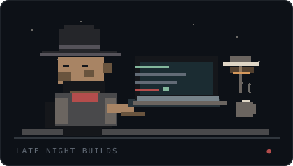

# Sergio García Orvich

I’m into **Linux, networks and security**, but I keep finding excuses to build software.

It started with things I wanted to use myself. A better way to compare fuel prices. A way to fine-tune audio for competitive games. Now I'm working on a tool to make network troubleshooting less painful.

**I like the whole process:** figuring things out, making them work, testing them, and sharing the result.

Currently working on: <strong>NetTriage</strong> · Network diagnostics, made approachable.

 

---

## Things I've built

### 01 &nbsp; / &nbsp; [AlLitro](https://allitro.vercel.app/) &nbsp; ↗

**A fuel-price map for Spain.**

A fast way to find stations and compare what you're actually paying. It uses public fuel-price data, an interactive map and a searchable list of locations.

<a href="https://allitro.vercel.app/">**Open AlLitro →**</a> &nbsp; Live · Private source

<!-- ALLITRO_DEMO_START -->
<!-- ALLITRO_DEMO_END -->

---

### 02 &nbsp; / &nbsp; [FootstepLab](https://footsteplab.vercel.app/) &nbsp; ↗

**A little audio lab for competitive FPS players.**

Headset-specific EQ profiles and interactive audio tools for finding a clearer sound in games. Built with Web Audio and a lot of testing.

<a href="https://footsteplab.vercel.app/">**Open FootstepLab →**</a> &nbsp; Live · Private source

<!-- FOOTSTEPLAB_DEMO_START -->
<!-- FOOTSTEPLAB_DEMO_END -->

---

### 03 &nbsp; / &nbsp; NetTriage &nbsp; IN PROGRESS

**Network troubleshooting without the guesswork.**

An open-source network diagnostic tool I'm refining before its first public release. The repository will appear here when it's ready.

---

## What I work with

`Linux` &nbsp; `Networking` &nbsp; `Windows Server` &nbsp; `Bash` &nbsp; `PowerShell` &nbsp; `TypeScript` &nbsp; `React` &nbsp; `Git`

I’m learning as I go. The projects above are a better introduction than a long list of tools.

<strong>One more thing — the GitHub contribution snake 🐍</strong>

 

 
Generated automatically from real GitHub activity.

---

Thanks for stopping by. If a project looks useful, try it.
