 

### Hey, I'm Sergio.

I'm studying **Network Systems Administration (ASIR)** in Galicia, Spain. I'm interested in **Linux, networking, cybersecurity and practical software** — especially projects that solve problems beyond the classroom.

I use modern development tools and AI-assisted workflows, but the goal stays the same: **build things that work, test them, and keep improving them.**

---

### Selected work

| Project | What it does | Explore |
| :--- | :--- | :--- |
| **[AlLitro](https://allitro.vercel.app/)** | Explore and compare fuel prices at gas stations across Spain. | [Live app ↗](https://allitro.vercel.app/) |
| **[FootstepLab](https://footsteplab.vercel.app/)** | Audio calibration tools for competitive FPS players. | [Live app ↗](https://footsteplab.vercel.app/) |
| **NetTriage** | A practical network troubleshooting toolkit, currently being refined. | Open-source release planned |

*AlLitro and FootstepLab are live products with private source code. NetTriage will be featured here when its public release is ready.*

### My toolkit

`Linux` · `Networking` · `Windows Server` · `Bash` · `PowerShell` · `TypeScript` · `React` · `Git`

### What matters to me

- **Useful over flashy** — the problem comes before the tech stack.
- **Test, then ship** — working demos mean more than a long list of buzzwords.
- **Learn in public** — share the process and publish reliable tools when they're ready.

---

Currently building from Galicia, Spain · <a href="https://github.com/sergioorvich?tab=repositories">Explore my repositories</a>

