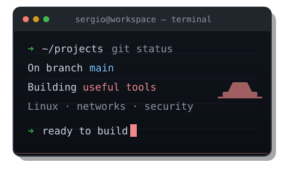

# Hey, I'm Sergio. 👋

**Systems, networks, cybersecurity — and tools worth building.**

I like turning everyday problems into software people can actually use. I work across systems administration and web development, learning by **building, testing and shipping**.

- 🛠️ **Building:** useful apps, practical tooling and better workflows.
- 🔐 **Exploring:** Linux, networking, security and automation.
- 🌱 **Next public release:** **NetTriage**, a network troubleshooting toolkit.

 

  

---

## 🚀 Featured projects

<table>
<tr>
<td width="50%" valign="top">

### ⛽ [AlLitro](https://allitro.vercel.app/)

Find and compare fuel prices across Spain. Real station data, search and an interactive map.

**[↗ Try AlLitro](https://allitro.vercel.app/)**

Live web app · Private source

</td>
<td width="50%" valign="top">

### 🎧 [FootstepLab](https://footsteplab.vercel.app/)

Audio calibration tools for competitive FPS games, including headset-specific profiles and interactive tuning.

**[↗ Try FootstepLab](https://footsteplab.vercel.app/)**

Live web app · Private source

</td>
</tr>
</table>

### 🌐 NetTriage — coming to open source

A practical network troubleshooting toolkit, currently being built and tested. It will have its own public repository when it is ready to release.

---

## 🧰 Tech & tools

  

 

**Things I enjoy:** Linux · Networking · Windows Server · Security · Scripting · Building practical web tools

---

## 🐍 Activity

The contribution animation is generated from my actual GitHub activity and updated by GitHub Actions.

---

  Less buzzwords. More things that work.

